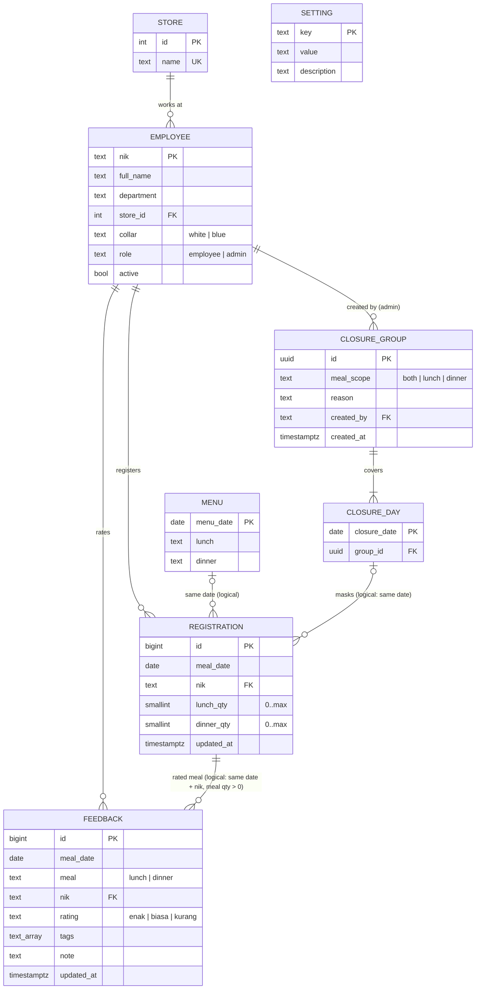

# Rebuild & Migration Prompt — Segari Program Makan

> **How to use this file.** Paste the whole document into your AI coding tool (or hand it to a developer) as the brief for rebuilding the app on a new stack. It describes the **current production system** (Google Apps Script + Google Sheets, deployed 2026-10) completely enough to rebuild it with feature parity: data model and relations, business rules, API, every screen, the design system, CSV formats, and a migration plan with acceptance tests.
>
> Source of truth for behaviour is the current code in this repo (`Code.js`, `App.html`, `Styles.html`). Where this document and the code disagree, the code wins — and please fix this document.

---

## 0. The ask (for the AI / developer reading this)

Rebuild "Segari Program Makan" as a production web app on **[TARGET STACK — fill in, e.g. Next.js + PostgreSQL, Laravel + MySQL, …]**.

- Keep **feature parity** with everything in sections 3–9.
- Use a **relational database** with the schema in section 3 (adapt types to the chosen DB).
- Keep **all UI copy in Bahasa Indonesia**, exactly as written here.
- Follow the **design system** in section 8 exactly (colors, sizes, radii, states).
- Enforce every business rule **on the server**; the client may also check them for UX, never instead.
- Provide a **one-off migration script** that imports the current Google Sheet (section 10).
- Ship with the **acceptance tests** in section 11 passing.

---

## 1. Product summary

Segari runs an office meal program. Employees register each month for **lunch ("Siang")** and **dinner ("Malam")** on specific dates. Each portion costs **Rp 5.000**, deducted from salary at month end.

| Role | Can do |
|---|---|
| **Karyawan (employee)** | Log in with NIK + full name; register / change / cancel meals for unlocked weeks; choose 1–N portions per meal (extra portions for guests or take-home); see this week's schedule and salary deduction; rate meals they ate. |
| **Admin** | Everything an employee can, plus: **Rekap porsi** (daily/monthly portion totals for the kitchen, per store and collar type, employee list, print sheet, CSV exports, change the weekly cutoff), **Masukan** (feedback dashboard, names visible), **Tutup kantin** (close the canteen on dates; affected registrations are not charged). |

Users: ~186 employees across stores (Kantor Pusat, gudang/warehouses, retail stores). Many blue-collar staff **do not have company Google accounts** — that is why login is NIK + name instead of SSO. Admin status is a role on the employee record, not a separate account.

---

## 2. Current architecture (what you are migrating from)

```
Browser (single-page app, vanilla JS, HtmlService iframe)
   │  google.script.run.api(action, token, payload)   — one RPC entry point
   ▼
Google Apps Script web app  (Code.js, runs as script owner, access "Anyone")
   │  SpreadsheetApp, LockService, CacheService, PropertiesService
   ▼
Google Sheet "Program Makmur Segari"  (ID 1-d3_QdcnV6YtEwx3CMkEZS60I5dtqsdajTZRWafXJW8)
   tabs: employee · pendaftaran · tutup · masukan · menu · pengaturan
```

- Apps Script project (prod): `1vf3DA43UPmEKgGk5-9tuBt0pZGyMlhIY4HhZLlXaoEuwlvpdCoKixz7M`, owned by a `segari.id` account.
- Repo: `github.com/k-rangga/segari-makmur`, deployed with `clasp`.
- **Time zone: Asia/Jakarta (UTC+7, no DST)** for every date and time rule.
- Dates are stored and exchanged as `YYYY-MM-DD` strings ("date keys"); weeks start **Monday**.
- Concurrency: every write takes a global script lock (20 s timeout).
- Sessions: stateless HMAC-signed tokens (see 4.9).

### Recommended target architecture (stack-agnostic)

```
SPA or SSR frontend  ──HTTPS/JSON──►  API server  ──►  Relational DB (Postgres/MySQL)
                                          │
                                          └─► (optional) object storage for CSV exports, cron for nothing — no jobs are required
```

No background jobs are needed: all "locking" is computed from the clock at request time.

---

## 3. Data model

### 3.1 Entity–relationship diagram



### 3.2 Relations and cardinality (read carefully — some are logical, not FK)

| Relation | Cardinality | Enforced how |
|---|---|---|
| Store → Employee | 1 : N | FK `employee.store_id`. Today store is free text on the employee row; normalize into `store`. An employee with no store is shown as **"Tanpa store"**. |
| Employee → Registration | 1 : N, **at most one row per (nik, meal_date)** | FK + `UNIQUE(meal_date, nik)`. One row holds both meals (`lunch_qty`, `dinner_qty`). A row with both qty = 0 means "registered nothing" (kept for history; equivalent to no row). |
| Employee → Feedback | 1 : N, **at most one per (nik, meal_date, meal)** | FK + `UNIQUE(meal_date, meal, nik)`. Upsert on resubmit. |
| Registration → Feedback | logical | Feedback is only accepted if the employee has a registration on that date with qty > 0 for that meal and the meal is not closed (rule 4.7). Do **not** FK feedback to registration — the registration row can later change. |
| Closure group → Closure day | 1 : N (≥1) | FK with `ON DELETE CASCADE`. One admin action ("close 12–16 Oct, lunch, Libur nasional") = one group with N days. "Buka kembali" deletes the whole group. |
| Closure day → date | **at most one closure per date** | `closure_date` is the PK. Creating a closure on dates that already have one **replaces** them (old day rows deleted first, in the same transaction). |
| Closure → Registration | logical mask | Closures **never delete or modify registrations**. Effective portions are computed: if the date is closed for a meal, that meal's qty counts as 0 everywhere (reports, cost, kitchen, feedback eligibility). Reopening a closure restores the original registrations automatically. |
| Menu → date | 0..1 per date | Optional display text for feedback prompts. |
| Employee → Closure group (`created_by`) | 1 : N | Today the sheet stores the admin's **name**; store the **nik** in the new DB and display the name. |
| Settings | singleton key/value | Keys in 3.4. |

### 3.3 Reference DDL (PostgreSQL — adapt as needed)

```sql
create table store (
  id          serial primary key,
  name        text not null unique
);

create table employee (
  nik         text primary key,                 -- digits today; keep as text (leading zeros, long ids)
  full_name   text not null,
  department  text,
  store_id    int references store(id),
  collar      text not null check (collar in ('white','blue')),
  role        text not null default 'employee' check (role in ('employee','admin')),
  active      boolean not null default true,
  created_at  timestamptz not null default now(),
  updated_at  timestamptz not null default now()
);

create table registration (
  id          bigserial primary key,
  meal_date   date not null,
  nik         text not null references employee(nik),
  lunch_qty   smallint not null default 0 check (lunch_qty between 0 and 10),
  dinner_qty  smallint not null default 0 check (dinner_qty between 0 and 10),
  updated_at  timestamptz not null default now(),
  unique (meal_date, nik)
);
create index registration_nik_date on registration (nik, meal_date);

create table closure_group (
  id          uuid primary key default gen_random_uuid(),
  meal_scope  text not null check (meal_scope in ('both','lunch','dinner')),
  reason      text not null default 'Kantin tidak tersedia' check (char_length(reason) <= 120),
  created_by  text references employee(nik),
  created_at  timestamptz not null default now()
);

create table closure_day (
  closure_date date primary key,                -- max one closure per date
  group_id     uuid not null references closure_group(id) on delete cascade
);

create table feedback (
  id          bigserial primary key,
  meal_date   date not null,
  meal        text not null check (meal in ('lunch','dinner')),
  nik         text not null references employee(nik),
  rating      text not null check (rating in ('enak','biasa','kurang')),
  tags        text[] not null default '{}',
  note        text not null default '' check (char_length(note) <= 500),
  updated_at  timestamptz not null default now(),
  unique (meal_date, meal, nik)
);
create index feedback_date on feedback (meal_date);

create table menu (
  menu_date   date primary key,
  lunch       text,
  dinner      text
);

create table setting (
  key         text primary key,
  value       text not null,
  description text
);

create table login_attempt (                    -- replaces CacheService throttle
  nik         text primary key,
  fails       int not null default 0,
  locked_until timestamptz
);

-- Effective (closure-masked) portions; use this for every report.
create view registration_effective as
select r.meal_date, r.nik,
       case when c.meal_scope in ('both','lunch')  then 0 else r.lunch_qty  end as lunch_qty,
       case when c.meal_scope in ('both','dinner') then 0 else r.dinner_qty end as dinner_qty
from registration r
left join closure_day d on d.closure_date = r.meal_date
left join closure_group c on c.id = d.group_id;
```

### 3.4 Settings keys

| Key | Default | Range | Meaning |
|---|---|---|---|
| `batas_hari` (cut.white.days) | `3` | −2–5 | White collar: registration for a week (Mon–Sun) closes N days **before that Monday**: 5 = Rabu, 4 = Kamis, **3 = Jumat**, 2 = Sabtu, 1 = Minggu (week before); 0 = Senin, −1 = Selasa, −2 = Rabu (inside the meal week). |
| `batas_jam` (cut.white.time) | `23:59` | `HH:MM` | White collar: time on the cutoff day at which the week locks (locked when now ≥ this minute). |
| `batas_hari_blue` (cut.blue.days) | = `batas_hari` | −2–5 | Same as `batas_hari`, for blue-collar employees. |
| `batas_jam_blue` (cut.blue.time) | = `batas_jam` | `HH:MM` | Same as `batas_jam`, for blue-collar employees. |
| `maks_porsi` (maxPortions) | `3` | 1–10 | Max portions per meal per day per employee. |

Constants (not settings today; may become settings): price **Rp 5.000/portion**; lunch window **11:30 – 13:30**; dinner window **18:00 – 20:00**; feedback opens **12:00** (lunch) / **18:30** (dinner); feedback editable until **meal date + 3 days** (inclusive); session length **30 days**.

Feedback tags (fixed list, in this order): `Porsi kurang`, `Kurang hangat`, `Terlalu asin`, `Terlalu pedas`, `Kurang variasi`, `Antre lama`, `Menu favorit`. ("Menu favorit" is a positive tag: excluded from "top complaint" counts and from the admin tag filter, which offers only the first six.)

### 3.5 Current sheet layout → new tables (for the migration script)

All tabs have a header row; columns are matched **by header name, case-insensitive**, so column order may vary.

| Sheet tab | Columns | → Table | Transform |
|---|---|---|---|
| `employee` | NIK, Nama, Departemen, Store, Kategori, Role, Aktif | `employee` (+ `store`) | `nik` = NIK with all whitespace removed, any characters allowed (numbers → string, no decimals). `collar`: Kategori contains "blue" → blue; contains "white" → white; else Departemen matches /gudang\|operasional/i → blue; else white. `role`: Role matches /admin\|hr/i → admin. `active`: false only if Aktif ∈ {tidak, no, false, 0, n, nonaktif} (case-insensitive), blank = true. Blank Store → "Tanpa store". Skip rows without NIK or Nama. |
| `pendaftaran` | Tanggal, NIK, Siang, Malam, Diperbarui | `registration` | Tanggal may be text `YYYY-MM-DD` or a Sheets date → format in Asia/Jakarta. Siang/Malam → int ≥ 0 (blank/invalid = 0). Diperbarui `yyyy-MM-dd HH:mm:ss` Jakarta → `updated_at`. If duplicates exist for (date, nik), keep the last row. |
| `tutup` | Grup, Tanggal, Waktu, Alasan, Dibuat oleh, Dibuat pada | `closure_group` + `closure_day` | Group rows by Grup (blank Grup → its own group per date). Waktu: contains both "siang" and "malam" / "keduanya" / "both" → both; "siang"/"lunch" → lunch; "malam"/"dinner" → dinner; anything else → both. Dibuat oleh is a **name** → look up the employee nik by name (null if not found). |
| `masukan` | Tanggal, Waktu, NIK, Nilai, Tag, Catatan, Diperbarui | `feedback` | Waktu "Malam"/dinner → dinner, else lunch. Nilai lower-cased; drop rows not in {enak, biasa, kurang}. Tag split on `;` and trimmed. |
| `menu` | Tanggal, Siang, Malam | `menu` | — |
| `pengaturan` | Kunci, Nilai, Keterangan | `setting` | A time value stored as a Sheets time → `HH:mm`. |

---

## 4. Business rules (server-enforced)

### 4.1 Time
- "Now" = server clock in **Asia/Jakarta**: `today` (date key) + `minuteOfDay` (0–1439).
- The client receives the server time at bootstrap and keeps a skew offset so countdowns match the server.

### 4.2 Weekly cutoff / locking
```
weekStart(d)  = Monday of d's week
cutoff(d, collar) = (weekStart(d) − cut[collar].days days) at cut[collar].time   // collar of the employee; days may be ≤ 0 (cutoff inside the meal week)
locked(d)     = d ≤ today OR today > cutoff.date OR (today == cutoff.date AND minuteOfDay ≥ minutes(cutoff time))
```
- Default: the week of Mon 12 Oct locks **Fri 9 Oct 23:59**.
- Past dates are always locked (their cutoff is earlier).
- Locked dates are **read-only** for employees: the server silently skips them in a save and returns the number skipped (`skipped`).
- Changing the cutoff (admin) affects only weeks that are not yet locked under the new rule.

### 4.3 Registration
- Unit of change: `(date, lunch_qty, dinner_qty)` for the logged-in employee.
- qty is clamped to `0..maxPortions`.
- If the date is closed for a meal, that meal's qty is forced to 0 on save.
- Upsert by (date, nik). Do not insert a new row when both quantities are 0.
- Batch limit: ≤ 400 changes per request. All changes in one request are applied atomically (one transaction / lock).
- An employee can only ever write their **own** registrations (nik comes from the session, never from the payload).

### 4.4 Cost
- Cost = effective portions × Rp 5.000. Closed meals cost nothing.
- Employee summary card: month total uses **saved** values for locked days and **draft** values for unlocked days.
- "{Month} sejauh ini": saved effective portions from the 1st of the current month **through today**.

### 4.5 Closures ("Tutup kantin")
- Admin picks a date range (from–to, inclusive). If "Lewati Sabtu & Minggu" is checked, Saturdays and Sundays are skipped **except the first selected date** (so you can close a single Saturday).
- Meal scope: both / lunch / dinner. Reason: free text ≤ 120 chars or a preset chip (`Libur nasional`, `Cuti bersama`, `Perawatan dapur`, `Acara kantor`). Empty → "Kantin tidak tersedia".
- Only dates ≥ today. Max 120 dates per action.
- Saving replaces any existing closure on those dates (same transaction), then creates one group.
- "Impact" shown before saving = over the selected dates and scope, using **raw** (unmasked) registrations: number of **distinct employees** with qty > 0, and **total portions**.
- "Buka kembali" deletes the whole group.
- Employees are "notified" by an **announcement card** on their home page (no email/push) for closures from today through today + 9 days.

### 4.6 Portions per meal
- Default 1 when selected. Popover allows 1..maxPortions. Copy: "1 porsi untuk kamu. Porsi tambahan untuk tamu atau dibawa pulang, maks. {max}."

### 4.7 Feedback
Accepted only if **all** hold:
1. rating ∈ {enak, biasa, kurang};
2. meal has started: date < today, or date == today and now ≥ 12:00 (lunch) / 18:30 (dinner);
3. today ≤ date + 3 days;
4. meal is not closed on that date;
5. the employee has an effective registration with qty > 0 for that meal.
- Tags filtered to the fixed list; note trimmed, ≤ 500 chars.
- Upsert by (date, meal, nik). Editable until the deadline.
- **Anonymity**: kitchen-facing CSV contains no names/NIKs. Admin UI shows "Name · Department" per comment with the label "Nama hanya terlihat oleh admin".

### 4.8 Login
- Input: NIK + full name. NIK normalized by removing whitespace; any characters allowed, no length limit; matched case-insensitively. Name compared **case-insensitively with whitespace collapsed** ("  rina   WULANDARI " matches "Rina Wulandari").
- Error messages (exact):
  - empty NIK → `NIK wajib diisi.`
  - unknown NIK → `NIK tidak ditemukan. Hubungi People & HR.` (counts as a failed attempt)
  - inactive → `NIK ini tidak aktif. Hubungi People & HR.`
  - empty name → `Nama wajib diisi.`
  - wrong name → `Nama tidak sesuai dengan NIK ini.` (counts as a failed attempt)
  - throttled → `Terlalu banyak percobaan. Coba lagi 15 menit lagi.` (after **8** failed attempts for a NIK, locked 15 minutes; success resets)
- Security note for the new stack: NIK + name is weak authentication (both are semi-public). Keep it for parity, but consider adding an optional PIN later. Never expose whether a name is close.

### 4.9 Sessions
- Today: token = base64url(`nik|expiryMs`) + "." + base64url(HMAC-SHA256(payload, secret)); secret stored server-side, created on first use; 30-day expiry; stored client-side in `localStorage` (`pm-token`).
- Every request re-checks: signature, expiry, employee exists **and is active**, and role for admin endpoints. Deactivating an employee ends their access immediately.
- Session errors return the sentinel `SESI_HABIS`; the client then clears the token and shows login with "Sesi berakhir. Silakan masuk lagi."
- New stack: any equivalent (signed cookie / JWT / DB session) with the same re-checks. Prefer an httpOnly cookie over localStorage.

### 4.10 Admin authorization
Admin endpoints require `role = admin`; otherwise error `Halaman ini khusus admin.` The admin nav items are hidden for non-admins, but the server is the gate.

---

## 5. API

Today there is one RPC function `api(action, token, payload)`. Below each action with a suggested REST equivalent. All dates `YYYY-MM-DD`, months `YYYY-MM`. Errors: HTTP 4xx with `{ error: "<Indonesian message>" }` (or the sentinel `SESI_HABIS` → 401).

| Action (current) | REST suggestion | Auth | Request | Response |
|---|---|---|---|---|
| `login` | `POST /api/login` | — | `{ nik, name }` | `{ token }` (or set cookie) |
| `bootstrap` | `GET /api/me/bootstrap` | user | — | see 5.1 |
| `saveRegistrations` | `PUT /api/me/registrations` | user | `{ changes: [{ date, l, d }] }` | `{ reg, saved, skipped }` |
| `saveFeedback` | `PUT /api/me/feedback` | user | `{ date, meal, r, tags[], note }` | `{ key: "YYYY-MM-DD-meal", fb: { r, tags, note } }` |
| `adminDay` | `GET /api/admin/day/:date` | admin | — | `{ date, rows[], lb, db, stores[], settings, now }` |
| `adminMonth` | `GET /api/admin/month/:ym` | admin | — | `{ ym, days[], stores[], split, now }` |
| `adminMonthDetail` | `GET /api/admin/month/:ym/detail` | admin | — | `[[date, nik, name, dept, store, collar, l, d], …]` |
| `adminFeedback` | `GET /api/admin/feedback` | admin | — | `{ from, to, sessions[], trend[], tags[] }` |
| `adminClosures` | `GET /api/admin/closures` | admin | — | `{ list[], taken[], now }` |
| `adminImpact` | `POST /api/admin/closures/impact` | admin | `{ dates[], meal }` | `{ people, portions }` |
| `addClosure` | `POST /api/admin/closures` | admin | `{ dates[], meal, reason }` | same as `adminClosures` |
| `removeClosure` | `DELETE /api/admin/closures/:groupId` | admin | — | same as `adminClosures` |
| `saveSettings` | `PUT /api/admin/settings` | admin | `{ cut: { white: { days, time }, blue: { days, time } } }` | `{ cut, maxPortions }` |

### 5.1 Bootstrap payload
```jsonc
{
  "user": { "nik": "20210001", "name": "Rina Wulandari", "dept": "Pemasaran", "store": "Kantor Pusat", "admin": false },
  "settings": { "cut": { "white": { "days": 3, "time": "23:59" }, "blue": { "days": 3, "time": "23:59" } }, "maxPortions": 3 },
  "now": { "key": "2026-10-05", "min": 845, "ms": 1791186300000 },
  "price": 5000,
  "months": ["2026-10", "2026-11", "2026-12"],          // current + next 2
  "fbTags": ["Porsi kurang", "…", "Menu favorit"],
  "fbEditDays": 3,
  "reg": { "2026-10-12": { "l": 2, "d": 0 } },           // own rows with qty>0, from min(weekStart(today), 1st of month) to end of month+2
  "closures": [{ "g": "g179…", "date": "2026-10-08", "meal": "both", "reason": "Perawatan dapur", "by": "Maya Siregar" }],
  "menus": { "2026-10-05": { "lunch": "Ayam bakar · sayur asem", "dinner": "Mie goreng · telur" } },  // today−14 … end of range
  "fb": { "2026-10-01-lunch": { "r": "enak", "tags": [], "note": "" } }                                 // own feedback, last 14 days
}
```

### 5.2 Admin shapes
- **Day row**: `{ nik, name, dept, store, collar: "white"|"blue", l, d }` — only employees with effective qty > 0; unknown NIK → name "(NIK tidak dikenal)", store "Tanpa store".
- `lb` / `db`: the closure object covering lunch / dinner that day, or `null`.
- **Month day**: `{ date, l, d, pl, pd, n, lb, db }` — portions lunch/dinner, people lunch/dinner, distinct people.
- **split**: `{ "<store>": [whiteLunch, whiteDinner, blueLunch, blueDinner] }`.
- **Feedback session**: `{ date, meal, list: [{ r, tags, note, who: "Name · Dept" }] }` for today−13 … today, excluding closed meals; sorted date desc, lunch before dinner.
- **Trend**: 8 items `{ ws, e, n }` (week start Monday, enak count, total) — weeks from (current week's Monday − 49 days) through the current week.
- **Closure list item**: `{ g, dates[], meal, reason, impact: { people, portions } }`, only groups whose last date ≥ today, sorted by first date. `taken` = all closed dates ≥ today.

---

## 6. Frontend — screens and behaviour

Global: single page, sidebar + main. All copy Indonesian. Re-render on state change; preserve input focus and inner scroll positions across renders. Every 30 s refresh time-dependent UI (countdowns, locks). `beforeunload` warns when there are unsent registration changes. Esc closes popover → modal → print sheet → dropdown panel (topmost first).

Persisted per-browser preferences (localStorage, all optional): `pm-token`, `pm-navClosed` (sidebar collapsed), `pm-hideWknd` (hide Sat–Sun), `pm-view` (last admin page), `pm-fbDismiss` (date the feedback banner was dismissed).

### 6.1 Login (full-screen)
- Two panels in a responsive grid (`repeat(auto-fit, minmax(min(100%,420px),1fr))`).
- Left (dark green): brand "**S**egari" (S in orange), "Program Makan", description "Daftar makan siang dan makan malam setiap bulan. Pilih hari, tentukan jumlah porsi, dan pantau makananmu. Setiap porsi Rp 5.000 dan dipotong dari gaji.", footer "Butuh bantuan? Hubungi admin program makan."
- Right: "Masuk" / "Masukkan NIK dan nama lengkap sesuai data HR."; fields "NIK (Nomor Induk Karyawan)" (any characters, no length limit, placeholder "cth. 20210001") and "Nama lengkap" (placeholder "cth. Rina Wulandari"); error box; submit "Masuk" ("Memeriksa…" while busy). The field the error refers to gets a 1.5px warning border (error text starting with "NIK" → NIK field, "Nama" → name field).
- On success toast "Selamat datang, {firstName}".

### 6.2 Sidebar
- Expanded 240px: logo tile + "Segari / Program Makan"; nav **Daftar makan** (all), **Rekap porsi**, **Tutup kantin** (admin only); footer avatar (initials), name, "{Admin | Department} · NIK {nik}", "Keluar" pill, collapse button.
- Collapsed 76px: logo, icon-only nav with tooltips, avatar, logout icon, expand button.
- Under 760px viewport width the sidebar is always collapsed (no expand button).
- "Keluar" with unsent changes asks: "Ada {n} perubahan yang belum dikirim. Keluar tanpa mengirim?"

### 6.3 Employee — "Daftar makan"
Top to bottom:

1. **Announcement card** (only if closures exist from today to today+9): title "Pengumuman minggu ini"; one row per closure group: date ("Kam 8 Okt" or "Sen 12 Okt – 16") and "Kantin tutup ({siang & malam|makan siang|makan malam}) · {reason}. Tidak ada biaya."
2. **Greeting**: "{Selamat pagi | siang | sore | malam}, {firstName}" — pagi < 11:00 ≤ siang < 15:00 ≤ sore < 18:30 ≤ malam. Sub: "Pilih hari makan setiap bulan · Rp 5.000 per porsi, dipotong dari gaji".
3. **Feedback banner** (only if: registered for today's lunch, not closed, now ≥ 12:00, no feedback yet, not dismissed today): "Bagaimana makan siang hari ini?" / "{menu or 'Makan siang hari ini'} · masukanmu dikirim tanpa nama ke tim dapur"; buttons Enak / Biasa / Kurang (open the feedback modal preselected); link "Nanti saja" (dismiss for today).
4. **This-week strip** "Jadwal makanmu minggu ini", right: "{12 – 18 Okt} · {n} porsi · Rp {cost}". 7 day cards Mon–Sun (horizontal scroll on narrow screens). Card states: today (green border + tint + "Hari ini" badge), past, weekend/closed (grey). Per meal row: status square ✓ (registered, lunch green / dinner orange-tint), empty (not registered), "–" with struck-through label (closed). Label "Siang ×2" when qty > 1. Feedback button under a registered meal once the meal started and within the deadline: "Beri nilai", or "Sudah dinilai · {Enak|Biasa|Kurang}" (disabled after the deadline).
5. **Month tabs**: current month + next 2. Sub-label: "{n} porsi · Draf" (unsent changes in that month) / "{n} porsi · Terkunci" (no editable day left) / "{n} porsi · Terkirim" / "Belum dipilih".
6. **Main area** (calendar column + sticky summary card):
   - **Lock bar** for the next not-yet-locked week W with cutoff C: if C is ≤ 24 h away → warning style "**Minggu {W} terkunci dalam {x jam y menit}.** Setelah itu pilihan minggu tersebut tidak bisa diubah, dan pilihan yang belum dikirim tidak tercatat." else open style "**Minggu {W} masih bisa diubah sampai {Jum 9 Okt, 23:59}.** Minggu yang sudah lewat batas tidak bisa diubah lagi."
   - **Toolbar**: "Isi cepat…" select → Hari kerja · Makan siang / Hari kerja · Siang + malam / Hari kerja · Makan malam / Setiap hari · Makan siang / Setiap hari · Siang + malam / Kosongkan bulan ini (applies to unlocked, non-closed days of the shown month; fill sets qty to max(current, 1)). Legend: Terdaftar, Belum terdaftar, Belum dipilih, plus meal chips **Siang** (green) and **Malam** (orange). Button "Sembunyikan Sab–Min" / "Tampilkan Sab–Min".
   - **Calendar grid**: first column = week label cell, then Mon–Fri (+ Sat–Sun). Week label: "Minggu ini · terkunci" / "Lewat" / "Terkunci" / "Batas hari ini 23:59" / "Sampai Jum 9 Okt"; for current/future weeks "{n} porsi" + cost; for editable weeks links "Isi minggu" / "Kosongkan" (Kosongkan offers undo via toast).
   - **Day cell**: date number + tag ("Tutup" or "Libur" if reason matches /libur|cuti/i; "Siang tutup"/"Malam tutup" for partial; "Terkunci" for locked future days). Out-of-month days are blank. Two meal chips "Siang" then "Malam".
   - **Chip states** (see 8.6): not chosen, pending add/change (dashed), pending removal (dashed + strikethrough), registered, qty > 1 ("Siang ×2"), closed (struck, disabled), locked (read-only).
   - **Interactions**: click an unselected chip → qty 1 (draft). Click a selected chip → **portion popover**. Mouse-down on a chip and drag across chips of the **same meal** paints them all to the opposite of the start chip's state; the click after a drag is suppressed.
   - Helper: "Ketuk untuk memilih, atau tahan dan geser untuk memilih beberapa hari sekaligus. Ketuk lagi untuk atur porsi atau hapus. Pilihan baru tercatat setelah kamu tekan Kirim pendaftaran."
   - **Sticky pending bar** (only with unsent changes; dark): "{n} pilihan baru · +Rp {Δ}" (all changes are additions) or "{n} perubahan · ±Rp {Δ}"; sub: if the earliest changed week locks within 24 h "Kirim sebelum {cutoff} — setelah itu minggu {W} terkunci dan perubahan ini hilang." else "Pilihanmu belum tercatat sampai kamu tekan Kirim pendaftaran."; buttons "Batalkan" (revert to saved, toast "Perubahan dibatalkan") and "Kirim pendaftaran" ("Mengirim…"). Success toast "Pendaftaran terkirim · {n} perubahan tercatat", or "Sebagian terkirim · {k} tanggal sudah terkunci dan tidak tersimpan".
   - **Summary card** (sticky): "{Month YYYY}" + status pill (Terkirim / Draf / Terkunci / Belum dipilih); rows Makan siang · Makan malam (dinner value in dinner color) · Kantin tutup "{n} hari"; divider; "Potongan gaji" Rp total; note "Termasuk pilihan yang belum dikirim." / "Semua pilihan sudah terkirim."; divider; "{Current month} sejauh ini": Porsi terdaftar, Potongan sejauh ini (bold); "Dipotong dari gaji akhir bulan."
7. **Portion popover** (260px, anchored under the chip, flips above, clamped 12px from edges, closes on scroll/resize/outside click): title "{Kamis}, {8 Okt} · {Makan siang|Makan malam}" (dinner title in dinner text color with swatch); − / + stepper (disabled at 1 / max); "{n} porsi" + cost; note (4.6); "Hapus" (sets 0) and "Selesai".
8. **Feedback modal**: "{Makan siang|Makan malam} · {Sen 5 Okt}", menu name (or meal name); "Bagaimana rasanya?" Enak / Biasa / Kurang; "Ada catatan? (opsional)" tag chips + textarea "Tulis masukan untuk tim dapur" (≤ 500); note "Tim dapur melihat masukan tanpa nama. Bisa diubah sampai {date+3}."; "Batal" / "Kirim penilaian" (edit: "Perbarui penilaian"; disabled until a rating is chosen). Success toast "Terima kasih! Masukanmu terkirim ke tim dapur".
9. **Toast**: bottom center, auto-hide 3 s (6 s when it has "Urungkan"/undo).

### 6.4 Admin — "Rekap porsi" (tabs Harian · Bulanan · Masukan)

**Harian**
- Title "{Senin, 5 Oktober 2026}" + date input (min today−400, max today+120).
- **Cutoff card**: past → "Sudah lewat · data final"; locked → "Porsi sudah pasti · pendaftaran minggu {W} ditutup {Jumat 2 Oktober, 23:59}"; open → "Masih bisa berubah · ditutup {…} ({x hari y jam} lagi)". Sub "Batas: setiap {Jumat} pukul {23:59} sebelum minggu makan". "Atur batas" opens inline editor: "Pendaftaran ditutup setiap" select grouped "Minggu sebelumnya" (Rabu … Minggu sebelum minggu makan) / "Minggu makan" (Senin … Rabu di minggu makan) and "Pukul" time input, one row each for White collar and Blue collar (when the two rules differ, the card lists each collar's cutoff separately and shows "Sebagian masih bisa berubah" when only one is locked), "Simpan" / "Batal", note "Berlaku untuk minggu yang belum terkunci. Karyawan melihat batas baru saat membuka aplikasi." Toast "Batas diubah · White collar {Jumat} {23:59} · Blue collar {Kamis} {17:00}".
- **Stat cards**: Makan siang (value or "Tutup"; sub "{n} karyawan · 11:30 – 13:30" or the closure reason in warning color), Makan malam (dinner color; "18:00 – 20:00"), Total porsi ("{n} karyawan terdaftar").
- **"Kebutuhan dapur per store"** table: sub "White collar {n} porsi · Blue collar {n} porsi"; buttons "Cetak untuk dapur", "Ekspor untuk dapur"; group header White collar (green rule) / Blue collar (brown rule); columns Store · Siang · Malam · Siang · Malam · Total; total row.
- **"Detail karyawan"** table: "{n} karyawan"; filters (single selects): Semua waktu makan / Makan siang / Makan malam; Semua store / each store; search "Cari nama, NIK, departemen" (also matches store); "Ekspor detail karyawan". Columns NIK · Nama · Departemen · Store · Siang · Malam, sortable (▲/▼; numeric columns sort descending first; ties by name). Empty states: "Kantin tutup pada tanggal ini." / "Tidak ada karyawan yang cocok." / "Belum ada karyawan terdaftar."
- **Print sheet** (overlay, "Tutup" / "Cetak" → `window.print()`, print CSS hides everything else): "Segari · Program Makan", "Kebutuhan dapur", date, status (first part of the cutoff head), "Dicetak {Sen 5 Okt 14:02}", 3 boxes (lunch, dinner, total), store table.

**Bulanan**
- **Month multi-select** (8.8) over current month −6 … +2; default = current month; empty = all 9. Buttons "Ekspor untuk dapur", "Ekspor detail karyawan".
- Stat cards (summed across selected months): Makan siang "Rata-rata {n} per hari kerja" (weekdays, excluding closed-for-lunch days), Makan malam (same, dinner color), Total porsi "Puncak {n} porsi · {date}" or "Belum ada pendaftaran".
- "Per store" table (summed split).
- **Day list**: Tanggal ("Sen 5", or "Sen 5 Okt" when >1 month selected; today bold; past muted) · Status pill (Tutup if fully closed; Libur if weekend with 0 portions; else Buka) · Siang · Malam (dinner color; "Tutup" when closed) · Total with mini stacked bar (lunch green, dinner orange, scaled to the max day). Fully closed rows tinted. Click a row → Harian for that date. Total row.

**Masukan**
- Filters — three **multi-selects** (8.8): Waktu makan (Makan siang, Makan malam), Penilaian (Ada yang menilai Enak / Biasa / Kurang), Catatan (first six tags). A session passes when, for **every** filter, it matches **any** selected value (empty filter = all). "Ekspor CSV untuk dapur".
- Period title "{22 September – 5 Oktober 2026}" (today−13 … today).
- Stat cards: Respons ({n}; "{k} sesi makan"), Menilai Enak ({p}%; green if ≥ 60 else warning; sub "{q}% menilai Kurang"), Catatan terbanyak (top non-"Menu favorit" tag; "{n} kali disebut" / "Belum ada catatan").
- Trend card "Penilaian “Enak” per minggu" / "8 minggu terakhir": bars height = % (px), green ≥ 60 %, `#C97A1E` below; "—" for weeks without data; week label "{14 Sep}".
- Session table: Tanggal · Waktu (meal pill) · Respons · Penilaian (stacked bar enak/biasa/kurang + "{p}% enak · {k} kurang", warning if < 50 %) · Catatan utama ("{tag} ({n})"). Low-score rows (< 50 % enak) tinted; selected row has a 3px green inset left bar. Empty: "Tidak ada sesi makan yang cocok dengan filter." / "Belum ada masukan dalam 14 hari terakhir."
- Comment card for the selected session (default first): "{Makan siang} · {date}" + "{n} respons · {a} enak, {b} biasa, {c} kurang"; pill "Nama hanya terlihat oleh admin"; comments with a note or tags, sorted kurang → biasa → enak: rating pill · note + tag chips · "Name · Dept". Empty: "Belum ada catatan tertulis untuk sesi ini."

### 6.5 Admin — "Tutup kantin"
- Header "Tutup kantin" / "Tutup satu tanggal atau rentang. Pendaftaran di tanggal itu dibatalkan, karyawan diberi tahu dan tidak dikenai biaya."
- **Form** "Tutup tanggal baru": Tanggal from / "sampai" / to (options today … today+90, "Sen 5 Okt"; "to" options ≥ from); checkbox "Lewati Sabtu & Minggu" (default on); segmented "Waktu makan": Siang & malam · Siang · Malam; "Alasan" chips + input "Atau tulis alasan lain".
- **Ringkasan** panel: range ("Sen 5 Okt – Rab 14 Okt"), "{n} hari · {Siang & malam|Makan siang|Makan malam}", impact numbers "karyawan sudah daftar" / "porsi dibatalkan" (loaded from the server, debounced 250 ms, "…" while loading), overlap warning "{n} tanggal sudah ditutup sebelumnya dan akan diganti dengan pengaturan ini.", "Pesan ke karyawan" preview "Kantin tutup {range} ({meal}) · {reason}. Pendaftaranmu dibatalkan dan tidak ada biaya.", CTA "Tutup {n} hari & beri tahu {people} karyawan" ("Menyimpan…"). Toast "{range} ditutup · {n} karyawan diberi tahu".
- **"Jadwal tutup mendatang"** ("{n} jadwal"): rows "{range} · {n} hari", "{meal} · {reason}", "{people} karyawan · {portions} porsi", button "Buka kembali" (toast "Jadwal dibuka kembali"). Empty: "Belum ada tanggal yang ditutup."
- After add/remove, the employee data and admin caches are refreshed.

---

## 7. CSV exports (UTF-8 with BOM, comma-separated, quote fields containing `," ; \n`)

| Export | Filename | Content |
|---|---|---|
| Kitchen, day | `dapur-porsi-{date}.csv` | `Tanggal,{date}` / `Makan siang,{n or Tutup}` / `Makan malam,{n or Tutup}` / blank / store table |
| Kitchen, month(s) | `dapur-porsi-{ym}.csv` or `dapur-porsi-{firstYm}_{lastYm}_{k}bulan.csv` | `Tanggal,Makan siang (porsi),Makan malam (porsi),Total porsi,Catatan` per day (Catatan = `Tutup siang+malam: {reason}` etc.) / blank / store table (summed) |
| Store table block | — | `Store,White collar siang,White collar malam,Blue collar siang,Blue collar malam,Total` … `Total,…` |
| Employee detail, day | `detail-karyawan-{date}.csv` | `Tanggal,NIK,Nama,Departemen,Store,Kategori,Makan siang (porsi),Makan malam (porsi)` — current filtered + sorted rows |
| Employee detail, month(s) | `detail-karyawan-{ym or range}.csv` | same header, every effective row of every selected month |
| Feedback (anonymous) | `masukan-makan-tanpa-nama.csv` | `Tanggal,Waktu,Penilaian,Catatan,Komentar` — filtered sessions, one line per response, **no names** |

Kategori values: `White collar` / `Blue collar`. Toast after export: "{label} · {n} baris".

---

## 8. Design system

Font `-apple-system, BlinkMacSystemFont, 'Segoe UI', system-ui, sans-serif`, antialiased; numbers `tabular-nums`; `box-sizing: border-box` everywhere. **No gradients, no emoji, no card shadows, no colored left-border accent cards, no illustrations.** Minimum hit target 44px (except text links and calendar-row links). Text contrast ≥ 4.5:1.

### 8.1 Colors
| Token | Hex | Use |
|---|---|---|
| green-600 | `#3B6D45` | Primary buttons, registered lunch, links, "Hari ini" badge, lunch bars, active tab underline, checked checkbox |
| green-700 | `#2B5234` | Primary hover, login left panel, active nav text, avatar text, lunch text on tint |
| green-100 | `#E3F1E5` | Nav active/hover, avatar bg, lunch tint, count badge bg |
| green-50 | `#EEF6EF` | Pending lunch chip bg |
| green-banner | `#F3F8F3` / border `#BFD8C2` | Feedback banner, open lock bar, today card |
| green-light-text | `#D6E8D5` | Secondary text on dark |
| **dinner accent** | `#F39A1E` | Dinner borders, swatches, bars; logo "S"; accent CTA "Kirim pendaftaran"; "Urungkan" |
| **dinner tint** | `#FDEBD0` | Selected dinner backgrounds, dinner pills |
| **dinner text** | `#8A4F00` | Dinner labels/values on white or tint (5.6:1 on tint) |
| dinner pending bg | `#FFF7EC` | Pending dinner chip |
| dinner locked | bg `#FEF5E9`, border `#F3C88A` | Locked registered dinner chip |
| orange-400 | `#F7AE47` | Accent hover |
| ink-900 | `#1E2A21` | Body text, pending bar, toast |
| ink-700 | `#3F4A43` | Secondary text |
| ink-500 | `#5F6B63` | Muted / helper |
| ink-400 | `#8A948D` | Placeholder, disabled |
| border-card | `#E4E6E2` | Cards, sidebar, table header rule |
| border-input | `#DADDD8` | Inputs, secondary buttons, chips |
| border-row | `#EEF0EC` | Row dividers, calendar grid |
| surface-page | `#EFEFEC` | Body, login right |
| surface-subtle | `#F8F9F7` | Total rows, row hover |
| surface-panel | `#F6F7F5` | Ringkasan panel |
| surface-seg | `#F0F1EE` | Segmented track, admin label pill |
| surface-cell-empty | `#F7F8F6` | Not-chosen chip |
| dim cell | `#FAFAF8` | Past / out-of-month cells, closed rows |
| btn-hover | `#F4F5F3` | Secondary hover (dropdown row hover `#F4F5F2`) |
| warn-bg | `#FBE7C6` | Login error, Draf pill |
| warn-bg-2 | `#FDEBD8` | Locked bars, Tutup pill, Kurang |
| warn-bg-3 | `#FFF8EC` / `#F3D19A` | Announcement card, low-score row |
| warn-text | `#9A5A0C` | Warnings, "Hapus", Kurang |
| blue-collar | text `#8A4B00`, rule `#A35A0A` | Blue collar group header |
| rating-kurang | `#C97A1E` | Kurang bar segment, low trend bar |
| rating-biasa | `#B7BDB8` | Biasa bar segment |
| print-rule | `#C9CEC9` | Print row dividers |
| overlay | `rgba(30,42,33,0.35)` (print `0.45`) | Modal backdrop |

**Meal color rule**: lunch = green (`#3B6D45` / `#E3F1E5` / `#2B5234`), dinner = orange (`#F39A1E` / `#FDEBD0` / `#8A4F00`). **Never white text on `#F39A1E`.**

### 8.2 Radius
4 pills/badges · 5–6 chips & status squares · 8 print sheet & small row buttons · 10 inputs/buttons/notice bars · 12 cards, nav items, login inputs, popover, dropdown panel · 14 pending bar · 16 modal · 999 pills/tag chips/"Keluar" · 50% avatars, collapse toggle.

### 8.3 Shadows (only these)
Popover & dropdown panel `0 12px 32px rgba(30,42,33,0.18)` · pending bar `0 12px 32px rgba(30,42,33,0.25)` · modal `0 24px 60px rgba(30,42,33,0.25)` · toast `0 10px 30px rgba(0,0,0,0.2)` · segmented active `0 1px 2px rgba(30,42,33,0.12)`. Cards: 1px border, no shadow.

### 8.4 Type scale
Login hero 44/800/−0.03em (lh 1.05) · login brand 28/800 · page H1 28/700/−0.01em · login H2 26/800 · stat value 24/700 (impact 24/800) · section title large 20/700 · card title 16–18/700 · body 15 (tables) / 14 (UI), lh 1.45–1.55 · meta 13 · small 12 · table header 12/700/0.04em UPPERCASE · badge 11/700.

### 8.5 Components
- **Buttons** — primary: `#3B6D45`, white, 14–15/700, h44, pad 0 20, r10 (hover `#2B5234`; disabled `#E4E6E2`/`#8A948D`). Secondary: white, 1px `#DADDD8`, 14/600, h40 (44 in toolbars), pad 0 16. Accent: `#F39A1E`, text `#1E2A21`, 14/700, h44 (hover `#F7AE47`). Ghost on dark: transparent, 1px `#5F6B63`, white (hover `#2B3A2F`). Text link: 12–13/600 `#3B6D45` (muted `#5F6B63`). Tag chip: h36, pad 0 12, r999, 13/600; on = `#3B6D45` border, `#E3F1E5` bg, `#2B5234` text.
- **Inputs/selects**: h40 (filters) or 44 (primary), pad 0 12 / 0 14, 14–15px, 1px `#DADDD8`, r10, focus/valid 1.5px `#3B6D45`, error 1.5px `#9A5A0C`. Checkbox 18×18 accent `#3B6D45`.
- **Tabs**: underline row (gap 8, bottom border `#E4E6E2`); tab pad 12 20 (month tabs 10 20), active 2px `#3B6D45` underline, 15/700 `#1E2A21`; inactive 15/500 `#5F6B63`; month sub-label 12px.
- **Stat card**: 1px `#E4E6E2`, r12, pad 18 20, gap 4; label 14 `#3F4A43` (8×8 meal swatch before lunch/dinner labels), value 24/700 (dinner value `#8A4F00`), sub 13 `#5F6B63`. Grid `repeat(auto-fit, minmax(200px,1fr))` gap 16.
- **Data table**: 1px border r12; toolbar pad 14 20; header pad 14 20 (16 20 in month/feedback tables); rows pad 14 20, 15px, gap 16, divider `#EEF0EC`, hover `#F8F9F7`; total row pad 16 20 bg `#F8F9F7` 700; numbers right-aligned tabular; empty pad 40 20 centered 14 `#5F6B63`.
- Grid templates: store `minmax(140px,1.4fr) repeat(4,minmax(70px,1fr)) minmax(80px,1fr)`; detail `96px minmax(0,1.3fr) minmax(0,1fr) minmax(0,1fr) 70px 70px`; month `110px minmax(0,1fr) 80px 80px minmax(170px,1.3fr)`; feedback `110px 70px 80px minmax(0,1.2fr) minmax(0,1fr)`; calendar `130px repeat(7,minmax(96px,1fr))` (min-width 860) or `130px repeat(5,minmax(110px,1fr))` (min-width 700).

### 8.6 Calendar meal chip (h44, full width, pad 0 7, r6, 13/700, left-aligned, ellipsis; hover brightness 0.96)
| State | Lunch | Dinner |
|---|---|---|
| Not chosen | 1px `#DADDD8`, bg `#F7F8F6`, text `#5F6B63` | same |
| Pending add/change | 2px dashed `#3B6D45`, bg `#EEF6EF`, text `#2B5234` | 2px dashed `#F39A1E`, bg `#FFF7EC`, text `#8A4F00` |
| Pending removal | as pending + line-through | as pending + line-through |
| Registered | 1px `#3B6D45`, bg `#3B6D45`, text white | **1.5px `#F39A1E`, bg `#FDEBD0`, text `#8A4F00`** |
| Qty > 1 | label "Siang ×2" | label "Malam ×2" |
| Closed | 1px `#E4E6E2`, bg `#F7F8F6`, text `#8A948D`, line-through, disabled | same |
| Locked, not registered | 1px `#E4E6E2`, white, `#8A948D`, disabled | same |
| Locked, registered | green at opacity 0.55 | bg `#FEF5E9`, border `#F3C88A`, text `#8A4F00` (no opacity) |

Day cell: min-h 116, pad 8 6, gap 6, borders `#EEF0EC`; past/out-of-month bg `#FAFAF8` (header opacity 0.5); fully closed `#F7F8F6`; today `inset 0 0 0 2px #3B6D45`.

### 8.7 Other specs
- Sidebar, login, this-week cards, lock bar, pending bar, summary card, popover, modal, toast, print sheet, closure form, segmented control, Ringkasan panel, upcoming list: exact paddings/sizes are in `Styles.html` (e.g. pending bar `position:sticky; bottom:16px; r14; pad 14 16 14 20`; popover 260px pad 16 gap 14, stepper buttons 44×44; modal `min(440px, 100vw−32px)`, pad 24, rating buttons h52 r12; toast bottom 28, pad 12 18, r12).
- Feedback rating selected states: Enak 2px `#3B6D45`/`#E3F1E5`/`#2B5234`; Biasa 2px `#5F6B63`/`#F0F1EE`; Kurang 2px `#C97A1E`/`#FDEBD8`/`#9A5A0C`.
- Status pills: Buka `#E3F1E5`/`#2B5234`; Tutup `#FDEBD8`/`#9A5A0C`; Libur `#F0F1EE`/`#5F6B63`; Terkirim `#E3F1E5`/`#2B5234`; Draf `#FBE7C6`/`#9A5A0C`; Terkunci `#F0F1EE`/`#3F4A43`. Meal pills: Siang `#E3F1E5`/`#2B5234`, Malam `#FDEBD0`/`#8A4F00`.
- Legend meal chips: h24, pad 0 8, r999, tint bg + text color, 10×10 swatch r3.

### 8.8 Multi-select dropdown (month picker + 3 feedback filters only)
- Trigger: looks like a select — h44, r10, 1px `#DADDD8`, white, `#1E2A21`, 15px, chevron right (rotates when open). Widths: month 200, Waktu makan 200, Penilaian 220, Catatan 200.
- Label: none selected → placeholder ("Semua bulan", "Semua waktu makan", "Semua penilaian", "Semua catatan"); one → its name; two+ → "{Bulan|Waktu makan|Penilaian|Catatan} ·" + badge "{n} dipilih" (12/700, pad 2 7, r999, `#E3F1E5`/`#2B5234`; badge never truncated, the noun may ellipsize).
- Panel: white, r12, 1px `#E4E6E2`, popover shadow, max-height 280 scroll, min-width = trigger, max 320px. Pinned header row: "Pilih semua" (green link) / "Kosongkan" (muted link). Option rows min-h 40, pad 8 10, r8, hover `#F4F5F2`, checkbox 18×18 r5 (checked `#3B6D45` fill + white check; unchecked 1px `#DADDD8`). Options keep their list order.
- Behaviour: empty selection = "Semua"; ticking an item replaces "Semua"; clearing returns to it. Outside click or Esc closes. ARIA: `aria-haspopup="listbox"`, `aria-expanded`, `role="listbox"` `aria-multiselectable`, `role="option"` `aria-selected`.

### 8.9 Responsive
- ≤ 760px: main padding `24px 16px 72px`; sidebar forced collapsed; summary card full width, not sticky; comment rows stack; print sheet padding 24; login panels stack.
- No horizontal page scroll at 375px; wide tables and the calendar scroll inside their own containers.

---

## 9. Non-functional requirements
- **Concurrency**: registration save, feedback save, closure add/remove and settings save run in a transaction; uniqueness constraints prevent duplicates under concurrent submits.
- **Performance**: ~186 employees × ~22 dates/month ≈ 4k registration rows/month. Index `(meal_date, nik)` and `(nik, meal_date)`. Admin month = one grouped query over `registration_effective` joined to `employee`/`store`.
- **Audit**: keep `updated_at`; consider an append-only `registration_log` (nik, date, old, new, at) — salary deduction disputes are likely.
- **Payroll**: monthly deduction per employee = Σ effective portions × 5000 for the month. Add an admin export "Potongan gaji per karyawan" (not in the current app — recommended).
- **Accessibility**: focus preserved across re-renders; dialogs `role="dialog" aria-modal`; toast `role="status"`; all icon buttons have `aria-label`/`title`.
- **Hosting**: must be reachable without a Google account (public URL), HTTPS only.

---

## 10. Migration plan

1. **Freeze window**: pick a cutover time right after a weekly cutoff (e.g. Saturday morning) so the next week is already locked.
2. **Export** each tab of the Google Sheet (File → Download → CSV per tab, or via the Sheets API with the owner account).
3. **Import** in this order (respect FKs): `setting` → `store` → `employee` → `menu` → `registration` → `closure_group` + `closure_day` → `feedback`. Apply the transforms in 3.5. Log and skip invalid rows (bad dates, unknown NIKs for registration/feedback → report them, do not drop silently).
4. **Verify parity** (script it): for every date in the last 60 days and next 60 days compare per-day totals (lunch, dinner, people) and per-store split between the old `adminMonth` output and new queries; compare each employee's current-month deduction. Must match exactly.
5. **Sessions**: old tokens are not migrated — everyone logs in once more.
6. **Cutover**: point employees to the new URL; set the old Apps Script deployment to show a redirect page (or archive it). Keep the sheet read-only as a backup for at least one payroll cycle.
7. **Rollback**: if parity fails, keep the Apps Script app live (it keeps working on the sheet) and re-run the import after fixes.

---

## 11. Acceptance tests (minimum)

Use clock injection; Asia/Jakarta.

1. Login: correct NIK + name (any case/extra spaces) succeeds; wrong name → "Nama tidak sesuai dengan NIK ini."; 8 wrong attempts → throttled 15 min; inactive employee rejected; deactivating a logged-in employee ends their session on next request.
2. Cutoff: with defaults, on Fri 9 Oct 23:58 a change to Mon 12 Oct saves; at 23:59 it is skipped (`skipped = 1`) and the UI shows the week as locked.
3. Changing `batas_hari` to 1 (Minggu) unlocks/locks weeks accordingly on the next request.
4. Portions clamp to `maks_porsi`; qty 0 for both meals on a new date creates no row.
5. Drag-select paints only chips of the same meal and only unlocked, non-closed days; the click after the drag does nothing.
6. Closing a date masks registrations in all reports and costs; reopening restores them unchanged. Overlapping closure replaces the old one and the UI warned about it.
7. Feedback: rejected before 12:00 for today's lunch, after date+3, when closed, or when not registered; upsert on resubmit; kitchen CSV has no names.
8. Month multi-select: two months selected → stat cards, store split, day list (with month names) and both CSVs contain both months; "Kosongkan" → "Semua bulan" (all 9 months).
9. Feedback filters: AND across filters, OR within a filter; counts and CSV follow the filters.
10. Dinner colors: registered dinner chip = `#FDEBD0` bg, 1.5px `#F39A1E` border, `#8A4F00` text; all text/background pairs ≥ 4.5:1.
11. Responsive: no horizontal page scroll at 375px; sidebar collapsed under 760px.
12. Parity script (section 10.4) passes on a copy of production data.

---

## 12. Known gaps / improvements to consider during the rebuild
- Authentication is NIK + name only (weak) — consider a per-employee PIN or OTP via WhatsApp.
- "Notify employees" is an in-app announcement only — consider WhatsApp/email.
- No payroll export per employee yet (see section 9).
- No audit log of registration changes.
- Store and department are free text in the sheet — normalize (store table, optional department table).
- Closure `created_by` is a name in the sheet — use nik.
- Admins cannot edit employees in-app (done in the sheet) — add an employee admin screen or an import.
- Menus are entered in the sheet — add a small admin screen.
